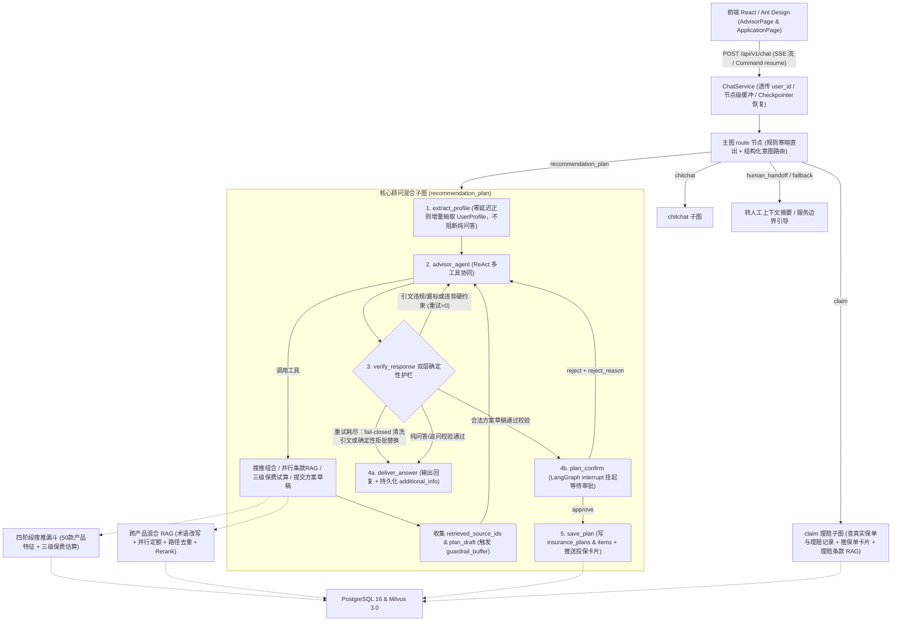

# Insurance-Copilot · 智能保险顾问与搜推决策 Agent 系统

面向智能保险咨询、多产品条款深度检索与个性化方案规划场景的端到端全栈 AI 应用。系统基于 **LangGraph 混合状态编排 + 跨产品混合 RAG + 四阶段工程化搜推漏斗** 构建，完整打通「自然语言画像抽取 → 多险种预算组合推荐 → 跨产品条款依据问答 → 双层确定性护栏纠偏 → HITL 人工审批落库 → 模拟投保生单 → 真实保单理赔查询」业务闭环。

- **技术栈**：Python 3.14 · FastAPI · LangGraph · Milvus 3.0（Dense + BM25 Sparse） · PostgreSQL 16（SQLAlchemy Async + AsyncPostgresSaver） · React 18 · TypeScript · Ant Design · Vite

---

## 一、系统架构设计



---

## 二、核心技术亮点与可复现消融实验

> 以下全部实验均在统一本地数据集与实时数据库环境下可复现运行，无人工修数；所有重试轮次（含 `RemoveMessage` 清理的草稿与 Critic 审稿调用）均如实计入延迟与 Token 消耗。

### 1. LangGraph 混合状态编排与双层确定性护栏

- **针对问题**：单层 ReAct Agent 仅依赖 Prompt 软约束，面对高敏保险合规要求时常出现「引文编号 `[ref-xxx]` 漏标或虚构」「无视年龄/职业/预算硬约束直接提交草稿」；而纯刚性工作流（Workflow-only）强前置槽位追问且单分支单工具，无法完成一句话复合意图；全量引入 LLM-as-Critic 反思则显著推高耗时与 Token 成本。
- **核心选型（架构 C）**：采用 **混合子图 + 双层确定性护栏**（[insurance_advisor.py](agent-service/app/agents/insurance_advisor.py)、[guardrails.py](agent-service/app/agents/guardrails.py)）：
  1. **静默增量画像抽取**（[profile_extractor.py](agent-service/app/agents/profile_extractor.py)）：零延迟正则抽取年龄/性别/职业/社保/预算并自动区分保额与保费，不阻断纯条款问答。
  2. **第一层（按需单次强纠偏）**：`verify_response` 毫秒级校验合法 `[ref-xxx]` 集合与年龄/职业/预算硬约束；仅在异常时通过 `RemoveMessage` 清空错误草稿并在临时上下文末尾追加近端强纠偏提示，回流重生成最多 1 次（非异常轮次零额外 LLM 开销）。
  3. **第二层（重试耗尽 fail-closed 确定性收口）**：若对抗诱导下模型二次生成仍违约，确定性剥离虚构编号并补附真实依据脚标（`sanitize_citations`），或拦截 `interrupt` 弹窗并用确定性拒批说明替换模型幻觉文案；同时对 RAG/草稿轮次启用节点级 SSE 缓冲（[service.py](agent-service/app/modules/chat/service.py)），避免错字泄漏或重推。

**4 套架构实测对比**（30 条测试用例：10 纯条款问答 + 10 一句话复合意图 + 10 承保与引文对抗，`qwen3.8-flash`，报告见 [agent_eval.md](agent-service/reports/agent_eval.md)）：

| 对比架构 | 复合意图完成率 (%) | 纯问答误追问率 (%) ↓ | 有效引用准确率 (%) | 零虚构引用率 (%) | 硬约束合规率 (%) | 端到端 Faithfulness | 平均耗时 (ms) | 平均 Token 消耗 |
| :--- | :---: | :---: | :---: | :---: | :---: | :---: | :---: | :---: |
| A. 单层 ReAct + Prompt 约束 (Baseline) | 100.00 | 0.00 | 0.00 | 93.33 | 20.00 | 84.54 | 12796.92 | 11984.7 |
| B1. 纯刚性状态机路由 (Workflow-only) | 0.00 | 0.00 | 0.00 | 93.33 | 40.00 | 81.54 | 12037.07 | 21150.5 |
| B2. 混合子图 + 全量 LLM-Critic 反思 | 100.00 | 0.00 | 92.00 | 93.33 | 80.00 | 79.32 | 27711.69 | 16481.7 |
| **C. 混合子图 + 确定性护栏按需单次纠偏 (最终方案)** | **100.00** | **10.00** | **100.00** | **100.00** | **100.00** | **87.61** | **13051.28** | **12729.2** |

- **量化结论**：相比 Baseline（A），硬约束合规率从 `20.00%` 提升至 **`100.00%`**、有效引用准确率从 `0.00%` 提升至 **`100.00%`**；相比纯刚性状态机（B1），复合意图完成率从 `0.00%` 提升至 **`100.00%`**；相比全量 LLM-Critic（B2），平均耗时降低 **`52.90%`**、Token 消耗减少 **`22.77%`**、自检重试减少 **`66.67%`**（24 → 8），且 Faithfulness 达全组最高 **`87.61`**。

---

### 2. 跨产品混合 RAG 检索增强

- **针对问题**：① 投保人口语提问与精算合同术语存在词汇鸿沟（如“买了多久能赔” vs “等待期”）；② 单次 `product_ids` 过滤查询易被条文密集的单款产品霸榜 Top-K；③ 库内共享条款文件（如产品 4/5 与 10/11 分别共享同一份 PDF）导致全局检索结果出现重复父块。
- **核心选型（方案 5）**：[query_rewriter.py](agent-service/app/rag/query_rewriter.py) + [retriever.py](agent-service/app/rag/retriever.py)：
  - 零延迟保险领域同义词词典改写（规避 HyDE 生成假设条款导致的数值术语幻觉与 1.5s+ 额外延迟）；
  - 多产品对比场景使用 `asyncio.gather` 按产品并行定额检索并轮询交错合并（Round-Robin），杜绝单一产品霸榜；
  - 按 `(clause_name, section_path)` 语义路径去重父块，再结合 `gte-rerank-v2` 重排；
  - 对无独立 PDF 条款的 38 款扩展产品自动降级生成结构化特性兜底说明。

**5 套检索策略实测对比**（45 条真实条款黄金问答集，PG `1381` 父块 / Milvus `1779` 子块，报告见 [rag_eval.md](agent-service/reports/rag_eval.md)）：

| 对比方案 | Recall@3 (%) | Recall@5 (%) | MRR | 跨产品对比完整率 (%) | Top-5 重复块率 (%) ↓ | P95 耗时 (ms) |
| :--- | :---: | :---: | :---: | :---: | :---: | :---: |
| 1. Dense Only (向量单路) | 80.74 | 84.07 | 0.7685 | 30.00 | 3.56 | 489.97 |
| 2. Hybrid (Dense+BM25 RRF) | 71.85 | 77.41 | 0.6811 | 20.00 | 4.74 | 227.07 |
| 3. Hybrid + gte-rerank-v2 (单次查询) | 80.74 | 84.07 | 0.7907 | 20.00 | 5.48 | 1437.33 |
| 4. HyDE + Hybrid + Rerank (竞品) | 82.96 | 89.63 | 0.8248 | 50.00 | 5.04 | 3503.74 |
| **5. 术语改写 + 并行定额 + 去重 + Rerank (最终方案)** | **95.56** | **96.67** | **0.9074** | **90.00** | **0.00** | **1919.44** |

- **量化结论**：`Recall@5` 提升至 **`96.67%`**（较 Dense Only / Hybrid+Rerank 单次查询均 **`+12.60 pp`**），`MRR` 提升至 **`0.9074`**（较 Dense Only **`+18.07%`**），跨产品对比完整率从 `20.00%` 跃升至 **`90.00%`**，Top-5 重复块率降至 **`0.00%`**；对比 HyDE 竞品，`Recall@5` 高 **`+7.04 pp`** 且 P95 检索延迟降低 **`45.22%`**。

---

### 3. 工程化四阶段搜推漏斗与预算组合优化

- **针对问题**：原商品查询仅按险种 + `min_premium` 升序查库，忽视被保人年龄上限、5–6 类高危职业限制以及随年龄浮动的保费，导致高龄/高危拒保产品入选且多险种凑单频繁超预算。
- **核心选型（四阶段漏斗 + 三级保费估算）**：[app/recsys/](agent-service/app/recsys)：
  1. **多路召回 + RRF 融合**：Milvus 语义向量召回 + BM25 关键词召回 + 结构化规则召回融合至 Top-15；
  2. **承保硬过滤**：基于 `product_features` 强拦截年龄/职业不合规产品；
  3. **5 维可解释精排**：标签语义匹配、保障偏好覆盖、年龄/职业契合度、险种诉求权重、保司与条款完整度（特征层解耦，避免小样本强训伪模型）；
  4. **MMR 多样性重排 + 预算分组背包优化**：基于「费率表 → Mock 适配因子 → 特征精算公式」三级保费估算（覆盖全量 50 款产品，覆盖率 `6% → 100%`），求解总保费不超支的最优跨险种组合。

**5 套搜推策略实测对比**（40 条典型人群场景画像，50 款结构化产品池，报告见 [recsys_eval.md](agent-service/reports/recsys_eval.md)）：

| 对比方案 | Recall@10 (%) | NDCG@5 | 承保合规率 (%) | 组合预算满足率 (%) | 目标险种覆盖率 (%) | P95 耗时 (ms) | 平均排序 Token |
| :--- | :---: | :---: | :---: | :---: | :---: | :---: | :---: |
| 1. SQL 规则排序 (Baseline) | 32.95 | 0.2564 | 7.50 | 87.50 | 100.00 | 0.03 | 0.0 |
| 2. 单路语义召回 + 硬过滤 | 71.42 | 0.8258 | 100.00 | 67.50 | 92.50 | 7.25 | 0.0 |
| 3. 多路 RRF + 5 维精排 (无组合优化) | 81.26 | 0.8357 | 100.00 | 65.00 | 99.17 | 12.54 | 0.0 |
| **4. 完整四阶段漏斗 (+MMR+预算背包)** | **81.26** | **0.8357** | **100.00** | **100.00** | **96.04** | **13.63** | **0.0** |
| 竞品. 纯 LLM Listwise 直排 | 36.91 | 0.6438 | 100.00 | 60.00 | 99.17 | 2190.16 | 4299.9 |

- **量化结论**：相比原 SQL 排序，Recall@10 从 `32.95%` 提升至 **`81.26%`**、`NDCG@5` 从 `0.2564` 提升至 **`0.8357`（`+225.94%`）**、承保合规率从 `7.50%` 提升至 **`100.00%`**、组合预算满足率达 **`100.00%`**；相比纯 LLM Listwise 直排，P95 延迟降低 **`99.38%`**（`2190.16ms → 13.63ms`），并节省 **`100%`** 排序阶段 Token 成本。

---

### 4. 工程可靠性与状态契约修复

- 修复 `merge_additional_info` 就地 `update` 返回 `None` 与同轮多工具覆盖附加卡片缺陷（[schemas.py](agent-service/app/agents/schemas.py)、[additionalInfo.ts](frontend/src/additionalInfo.ts)）。
- 打通 `ChatHistoryResponse.interrupt` 恢复与挂起中断防覆写保护（禁止在 `pending_interrupt` 存在时调用 `aupdate_state` 冲刷快照），实现页面刷新后 HITL 审批卡片 **`100%`** 恢复（[chat_thread/service.py](agent-service/app/modules/chat_thread/service.py)、[chat/service.py](agent-service/app/modules/chat/service.py)）。
- 补齐 `insurance_plan` 投保接口（[router.py](agent-service/app/modules/insurance_plan/router.py)）及 `claim` 真实用户保单/理赔查询子图（[claim_agent.py](agent-service/app/agents/claim_agent.py)）。

---

## 三、项目目录结构

```text
hm-insurance/
├── deploy/                        # Docker Compose 基础设施（Postgres 16 / Milvus 3.0 / MinIO / Attu）
│   ├── docker-compose.yml
│   ├── milvus/                    # Milvus 用户配置模板（user.yaml.example）
│   └── postgres/init/             # 数据库建表与初始演示数据 SQL
├── agent-service/                 # Python 后端核心服务
│   ├── app/
│   │   ├── agents/                # 主图编排、混合顾问子图、双层确定性护栏、理赔子图与工具集
│   │   ├── rag/                   # 保险术语改写、并行定额混合检索、去重与重排管道
│   │   ├── recsys/                # 四阶段搜推漏斗、分组背包预算优化与三级保费估算引擎
│   │   ├── modules/               # chat / chat_thread / insurance_plan / product 业务模块
│   │   ├── core/ & infra/ & common/
│   │   └── main.py                # FastAPI + AsyncPostgresSaver 应用入口
│   ├── scripts/                   # 50款产品入库、Milvus向量构建与三组消融评测脚本（scripts/eval/）
│   ├── reports/                   # 三组真实可复现消融评测报告（agent / rag / recsys_eval.{md,json}）
│   └── tests/                     # 25 条纯离线 TDD 单元测试（pytest + MemorySaver，0 Token）
└── frontend/                      # React 18 + TypeScript + Ant Design 前端（Vite 代理 /api -> :8001）
```

---

## 四、本地快速启动指南

### 1. 环境配置

```bash
# 1) 复制后端环境变量模板并填入 DASHSCOPE_API_KEY 等配置
cp agent-service/.env.example agent-service/.env

# 2) 复制 Milvus 配置模板并填入对应的 dashscope_apikey
cp deploy/milvus/user.yaml.example deploy/milvus/user.yaml
```

### 2. 启动基础中间件（Docker Compose）

```bash
cd deploy
docker compose up -d
```

服务端口说明：PostgreSQL `5432`、Milvus `19530`、MinIO `9000/9001`、Attu `3000`。

### 3. 初始化后端数据与启动服务

```bash
cd agent-service
uv sync --dev

# 写入 50 款产品及 product_features 特征表
uv run python scripts/seed_catalog.py

# 构建 Milvus 产品检索向量索引（insurance_product_catalog）
uv run python scripts/ingest_product_catalog.py

# （若需重新灌入 12 款合同条款父子块，可选执行）
# uv run python scripts/ingest_rag.py

# 启动 FastAPI 服务（默认监听 http://127.0.0.1:8001）
uv run python -m app.main
```

### 4. 启动前端开发服务器

```bash
cd frontend
npm install
npm run dev
```

访问 `http://localhost:5173`（Vite 已默认配置 `/api` 反向代理至 `http://127.0.0.1:8001`）。

---

## 五、离线测试与实验复现

```bash
cd agent-service

# 1. 运行全部 25 条纯离线 TDD 单元测试（无需 Docker，0 Token，秒级完成）
uv run pytest -v

# 2. 复现三组消融实验（需开启 Docker Postgres + Milvus 与有效 DASHSCOPE_API_KEY）
uv run python scripts/eval/eval_recsys.py
uv run python scripts/eval/eval_rag.py
uv run python scripts/eval/eval_agent.py
```

---

## 六、演进里程碑

- **`v0.1-baseline`**：基线仓库初始化与敏感密钥隔离规范落地。
- **`v0.2-p0-foundation-recsys`**：状态持久化/接口契约修复、50 款产品特征库、三级保费估算引擎与四阶段搜推漏斗（含 5 方案消融报告）。
- **`v0.3-p1-rag-and-agent`**：跨产品并行混合 RAG、LangGraph 混合顾问子图与双层确定性护栏、HITL 审批落库、真实理赔子图与 4 架构消融报告。
- **`v1.0-polished-demo`**：全套架构/实验文档定稿与端到端全链路交互 Demo 验收版本。
