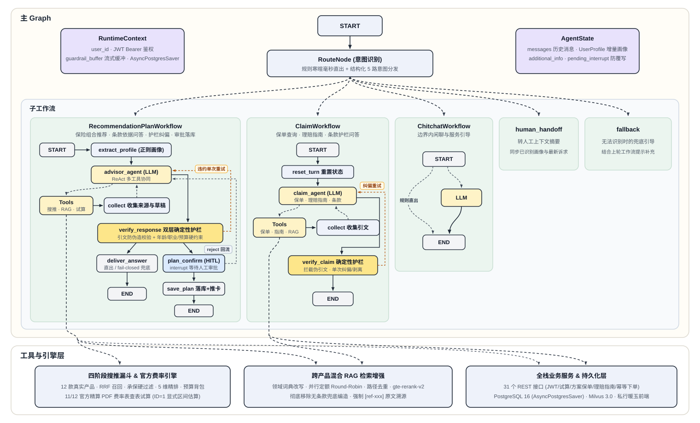

<div align="center">

# Insurance-Copilot

**LangGraph 混合双子图编排 · 12 款真实备案产品与官方费率表 · 跨产品混合 RAG · 四阶段搜推与确定性护栏**

<p align="center">      </p>

[项目简介](#项目简介) · [核心工作与结果](#核心工作与结果) · [功能与设计](#功能与设计) · [系统架构](#系统架构) · [快速开始](#快速开始) · [验证与评测](#验证与评测) · [代码与文档](#代码与文档)

</div>

## 项目简介

**一句话定位**：把「30 岁软件工程师、年预算 4000 元、想配重疾+医疗并对比两款产品等待期」这类自然语言诉求，转化为**承保合规、保费有官方费率表依据、条款有原文编号溯源、落库经人工审批确认**的保障方案与投保/理赔闭环。

纯大模型直接做保险咨询有四类典型故障：编造条款细节与伪造引用编号、忽视投保年龄/高危职业/预算红线乱推产品、缺乏精算费率表凭空报价、跨产品对比检索被单一高频条款霸榜漏答。本系统把大模型生成包裹在一套**真实备案事实源 + 四阶段搜推与跨产品混合 RAG + 双层确定性护栏 + 人工审批**闭环之中：先从 12 款真实备案合同与官方精算费率表筛选合规候选，再经条款原文溯源、输出前流式拦截校验和单次纠偏收口，最后交由用户确认落库。

| 层 | 实际技术选型 | 在本项目里承担什么 |
| :--- | :--- | :--- |
| 编排 | LangGraph 1.2 | 主图 5 路意图路由、推荐与理赔双子图协同、多轮上下文维护与会话断点恢复 |
| 服务 | FastAPI + SSE + JWT + Argon2 | 31 个全栈业务接口、用户鉴权与密码加密、流式校验缓冲、幂等下单与撤单 |
| 模型 | 通义千问（OpenAI 兼容接口） | 意图识别、画像抽取与工具调度、语义重排、异构强模型忠实度评审 |
| 事实源 | 12 款真实备案合同 + 10 份官方精算 PDF | 真实承保规则与条款原文；`1,594` 条官方费率覆盖 `11/12` 款产品（1 号产品显式标注估算） |
| 存储 | PostgreSQL 16 + Milvus 3.0 + MinIO | 业务数据与会话状态持久化、稠密向量与关键词稀疏混合检索索引 |
| 前端 | React 18 + TypeScript + Ant Design 5 + Vite 6 | 私行典雅·暖金玉石精简界面：目录检索、私享顾问流式溯源、方案确认、试算投保与理赔 |

**系统能力**：多轮增量画像抽取 · 12 款真实产品目录 · 11/12 官方精算费率查表 · 四阶段搜推与预算背包优化 · 跨产品并行混合 RAG 与无条款拒编 · 确定性引用与承保红线护栏 · 人工确认落库 · 31 个全栈接口与理赔指引闭环。

---

## 核心工作与结果

### 1. 混合双子图编排与确定性合规护栏：把「生成」与「核验」做成有界闭环

主图在入口完成高频寒暄规则直出与 5 路意图分发，将核心咨询分别收口到保险规划子图与理赔服务子图。模型生成回复时先在服务端暂存缓冲，由确定性护栏同步核查引文编号真实性与年龄/职业/预算等承保红线：发现异常仅允许带错误反馈重跑 1 轮，仍不合规即执行强制清洗或确定性拒批；提交保障方案前还会挂起等待用户审批确认，批准后才写入数据库。

- **解决**：单层对话加提示词约束在复合意图与对抗测试下容易漏检条款、乱加 `[ref-099]` / `[d64a1]` 等伪编号，且容易反复返工或把错误草稿提前流式吐给前端。
- **结果**：在 `30` 条测试集上（被测模型 `qwen3.8-flash`，异构 `qwen-max` 评审），最终方案实现复合意图完成 **`100.00%`**、误追问 **`0.00%`**、自主有效标引 **`100.00%`**、零虚构引用 **`100.00%`**、约束零违规 **`100.00%`**、对抗合规解决 **`100.00%`**（Baseline 对应项分别为 `0.00% / 20.00% / 0.00% / 96.67% / 30.00% / 0.00%`）。

### 2. 跨产品混合 RAG 检索增强：口语术语对齐与拒绝无依据兜底

检索链路由领域词典零延迟同义词改写、向量 + 关键词双路融合、跨产品并行定额召回与轮询交错合并、条款语义路径去重以及 `gte-rerank-v2` 重排五部分组成；同时彻底移除早期未命中条款时由模型凭空概括的兜底逻辑，检索为空时直接明确告知「未查询到对应条款」。

- **解决**：未对齐的口语词汇（如「买完多久能赔」「后悔退保」）直接进入关键词检索易匹配噪声导致召回下降；单次全局检索对比常被单一密集产品霸榜；共享同一份 PDF 的不同产品易产出重复文本块。
- **结果**：在 `45` 条真实合同问答的 7 路单变量消融中，最终方案 `Recall@5` 达 **`96.67%`**、MRR **`0.9074`**、跨产品对比完整率 **`90.00%`**（单路向量仅 `30.00%`）、Top-5 重复块率降至 **`0.00%`**；相比 HyDE 竞品方案，召回高 `+9.26 pp`（`96.67% vs 87.41%`）且 P95 延迟降低 **`54.17%`**（`1642.75 ms vs 3584.18 ms`）。

### 3. 四阶段工程化搜推漏斗与分组背包预算优化

推荐链路拆分为「多路召回融合 → 承保硬过滤 → 5 维可解释精排 → 多样性重排与预算分组背包优化」四个阶段，把所有承保规则与预算分配收口到确定性算法中完成。

- **解决**：传统 SQL 规则排序缺少承保资格门禁与多险种预算统筹，纯大模型列表直排延迟高且预算违规频发。
- **结果**：在 `30` 条独立人工标注场景画像 × 12 款真实产品的离线基准中，完整四阶段漏斗较原版 SQL 基线将 `Recall@3` 从 `48.80%` 提升至 **`71.44%`**、`NDCG@5` 从 `0.6294` 提升至 **`0.9204`**、承保资格合规率从 `20.00%` 提升至 **`100.00%`**、组合预算满足率从 `76.67%` 提升至 **`100.00%`**；相比纯大模型直排，`Recall@3` 高 `+8.33 pp`、排序 P95 耗时降低 **`99.63%`**（`1807.89 ms → 6.74 ms`）且排序阶段 **0 Token** 消耗。

### 4. 产品库去虚构收口与官方精算 PDF 费率表引擎

移除早期 38 款无条款 PDF 支撑的扩展虚构产品，产品目录严格收敛为 **12 款真实备案合同（`ID 1-12`）**。通过离线解析脚本提取 10 份官方精算费率表 PDF，共将 `1,594` 条精算费率写入数据库，覆盖 **`11/12`** 款真实产品（`ID 2-12`）；缺失官方费率表 PDF 的 1 号产品（达尔文宝贝计划 12 号）在查价与试算时强制返回「公式估算」标记与明确免责声明。

- **解决**：虚拟产品污染检索与推荐池、前端动态试算保费与真实精算口径脱节、缺少费率表时静默估算误导用户。
- **结果**：11 款真实产品支持性别、投保年龄、缴费期、保障期、吸烟及社保状态等真实维度精确查表，无表产品强制显式声明，后端定价单测全通过。

### 5. 全栈业务闭环、私行精简前端与仓库安全脱敏

打通全部 **31 个**全栈业务接口（注册登录与无感刷新、产品筛选与动态试算表单、方案转保单快照、理赔指引与标准 PDF 申请书下载、幂等下单与级联撤单），并完成「私行典雅·暖金玉石」精简版前端全页面交互与生产构建验证。同时将涉版权原始 PDF 移出 Git 追踪，所有容器与模型密钥通过环境配置模板隔离注入。

### 关键量化结果（口径见[验证与评测](#验证与评测)）

| 维度 | 指标 | 结果 | 分子 / 分母与对照口径 |
| :--- | :--- | :--- | :--- |
| 工程 | 离线回归与构建 | **`26 passed`**（`7.45s`，0 网络） | 6 个后端测试模块 + 前端类型检查与构建 |
| 搜推漏斗 | Recall@3 / NDCG@5 | **`71.44%` / `0.9204`** | 30 场景 × 12 产品离线基准（SQL 基线 `48.80%` / `0.6294`） |
| 搜推漏斗 | 承保合规率 / 预算满足率 | **`100.00%` / `100.00%`** | 同批 30 场景（SQL 基线 `20.00%` / `76.67%`） |
| 搜推效率 | 排序 P95 耗时 / Token | **`6.74 ms` / `0.0`** | 对比纯大模型直排 `1807.89 ms` / `1288.6`（耗时 **-99.63%**） |
| RAG 检索 | Recall@5 / MRR | **`96.67%` / `0.9074`** | 45 条真实合同问答（单路向量 `84.07%` / `0.7685`） |
| RAG 对比 | 跨产品完整率 / Top-5 重复块率 | **`90.00%` / `0.00%`** | 10 条跨品对比 + 全集 45 条（单路向量 `30.00%` / `3.56%`） |
| RAG 对照 | 最终方案 vs HyDE 竞品 | **`96.67% vs 87.41%`**，P95 **`1642.75 ms`** | 召回 `+9.26 pp`，P95 较 HyDE（`3584.18 ms`）降 **54.17%** |
| Agent 编排 | 复合意图完成 / 误追问 | **`100.00%` / `0.00%`** | 30 条用例 `qwen3.8-flash`（Baseline `0.00%` / `20.00%`） |
| Agent 护栏 | 自主标引 / 零虚构 / 零违规 / 对抗解决 | **`100% / 100% / 100% / 100%`** | 同批 30 条（Baseline `0.00% / 96.67% / 30.00% / 0.00%`） |
| Agent 忠实度 | 异构 `qwen-max` Faithfulness | 全集 **`92.61`** / 公共交集 **`96.15`** | 全集 30 条（未调 RAG 记 0）；公共交集 `N=13` |

> **口径与已知边界**：① 搜推离线基准使用人工专家预标注相关性与承保红线（非线上点击日志）；② RAG 评测基于 12 款真实合同 45 条黄金问答，无条款产品不构造伪块；③ Agent 评测报告中方案 C 全集平均耗时 `24,020.5 ms`、平均 Token `150,621.6`，主要受单条极端用例 `C05`（单条触发异常循环消耗 `4,097,875` Token / `279.9 s`）拉高影响——剔除 `C05` 后其余 29 条正常样本均值为 **`14,509.4` Token / `15,196.2 ms`**（另含 `C04` 检索产品失配扣分，见下文剖析）。

---

## 功能与设计

| 功能 | 实现方式 | 设计目的 |
| :--- | :--- | :--- |
| 多轮画像抽取 | 正则规则先行提取年龄、职业、预算等关键槽位，并跨对话轮次增量合并，自动过滤「50 万保额」等易混淆数字 | 避免把保额误判为年预算或年龄，多轮追问不丢前序信息 |
| 真实目录与费率引擎 | 12 款真实备案产品入库；`11/12` 款基于官方 PDF 精算表查价，缺表产品显式标记为估算 | 消除虚拟产品幻觉，禁止静默编造精确报价 |
| 四阶段搜推与背包优化 | 多路融合召回 → 年龄与职业红线过滤 → 5 维相关性精排 → 多样性重排与多险种预算分组背包求解 | 把合规与预算约束交给确定性算法，兼顾零违规与排序 0 Token 开销 |
| 跨产品混合 RAG | 领域词典口语改写 → 向量与关键词双路检索 → 按产品并行定额与轮询交错 → 语义路径去重 → 语义重排 | 解决口语查词、热门产品霸榜与共享条款重复块问题，查无原文直接拒答 |
| 双层确定性护栏 | 对待输出草稿校验 `[ref-xxx]` 引文真实性与承保红线；不通过至多定向纠偏 1 次，仍违规即清洗或拒批 | 彻底封堵 `[ref-099]`/`[d64a1]` 伪引用，杜绝在文末强贴无关依据脚标 |
| 人工审批落库 | 推荐方案草案提交后进入暂停审批态，向前端推送确认卡片，经用户本人批准后再持久化落库 | 保障方案保存等写库关键操作可控可审计，刷新页面后支持断点恢复 |
| 理赔服务闭环 | 独立理赔子图集成真实保单进度查询、理赔材料指引、标准申请书 PDF 下载与同套引文护栏 | 让理赔咨询同样受原文溯源与流式缓冲保护，直通真实理赔单据与模板 |
| 试算与下单全闭环 | 动态下发各产品可调参数表单、实时保费试算、幂等键投保下单、完整保单快照生成与级联撤单 | 打通「AI 规划 → 试算调整 → 方案转投保 → 保单管理 → 理赔指引」全业务流程 |

<details>
<summary>展开查看全部 31 个全栈 REST 业务接口一览</summary>

| 业务域 | 方法 | 路径 | 说明 |
| :--- | :---: | :--- | :--- |
| **系统状态** | `GET` | `/healthy` | 健康检查接口 |
| **用户认证** | `POST` | `/api/v1/auth/register` | 用户注册（签发访问令牌与刷新 Cookie） |
| | `POST` | `/api/v1/auth/login` | 用户登录（支持已有演示账号密码哈希平滑升级） |
| | `POST` | `/api/v1/auth/refresh` | 刷新访问令牌 |
| | `POST` | `/api/v1/auth/logout` | 退出登录并清除刷新 Cookie |
| **产品中心** | `GET` | `/api/v1/products` | 分页查询 12 款真实保险产品 |
| | `GET` | `/api/v1/products/candidates` | 按险种与用户属性筛选候选产品 |
| | `GET` | `/api/v1/products/{product_id}` | 查询产品详情 |
| | `GET` | `/api/v1/products/{product_id}/pricing-schema` | 获取动态保费试算表单结构 |
| **保费试算** | `POST` | `/api/v1/premium/calculate` | 官方费率查表试算（1 号产品显式返回估算标识与免责声明） |
| **保障方案** | `GET` | `/api/v1/insurance-plans` | 列出当前用户历史保障方案 |
| | `GET` | `/api/v1/insurance-plans/current` | 获取当前生效保障方案及明细 |
| | `PUT` | `/api/v1/insurance-plans/current` | 保存或更新当前保障方案 |
| | `GET` | `/api/v1/insurance-plans/{plan_id}` | 获取指定方案详情 |
| | `PATCH` | `/api/v1/insurance-plans/{plan_id}/items/{item_id}/insured` | 标记方案子项已投保并生成完整保单快照 |
| **保单中心** | `GET` | `/api/v1/policies` | 查询当前用户全部真实保单 |
| | `GET` | `/api/v1/policies/{policy_id}` | 查询指定保单详情 |
| **理赔服务** | `GET` | `/api/v1/claims` | 查询理赔记录列表 |
| | `GET` | `/api/v1/claims/{claim_id}` | 查询理赔案件详情 |
| | `GET` | `/api/v1/claim-guides/{policy_id}` | 按保单查询理赔指引与材料清单 |
| | `GET` | `/api/v1/claim-guides/application-form` | 下载标准 PDF 理赔申请书 |
| **投保订单** | `GET` | `/api/v1/orders` | 查询投保订单列表 |
| | `POST` | `/api/v1/orders` | 创建投保订单（支持幂等键校验与保费复核） |
| | `GET` | `/api/v1/orders/{order_id}` | 查询投保订单详情 |
| | `POST` | `/api/v1/orders/{order_id}/cancel` | 撤单（级联校验并同步更新保单状态） |
| **智能对话** | `POST` | `/api/v1/chat` | SSE 流式对话与人工审批断点恢复 |
| | `POST` | `/api/v1/chat-threads` | 创建会话线程 |
| | `GET` | `/api/v1/chat-threads` | 列出用户会话线程 |
| | `PATCH` | `/api/v1/chat-threads/{thread_id}` | 重命名会话线程 |
| | `DELETE` | `/api/v1/chat-threads/{thread_id}` | 删除会话线程 |
| | `GET` | `/api/v1/chat-threads/{thread_id}/messages` | 获取消息历史与待审批挂起状态恢复 |

</details>

---

## 系统架构



> **架构概览**：主图统一维护当前用户身份、历史会话与多轮增量画像，由意图路由节点完成高频寒暄直出与 5 路业务分发；核心推荐规划与理赔服务以双子图隔离编排并共用确定性护栏，所有回答先经缓冲与引用/红线检验再推流给前端，确认保存方案前需经过人工确认暂停；底层工具层统一调度四阶段搜推与官方费率引擎、跨产品混合 RAG 检索及全栈持久化业务服务。

### 交付与兜底机制

| 状态 | 触发条件 | 系统与前端表现 |
| :--- | :--- | :--- |
| **直出交付** | 首次检验即无伪造引文且无年龄/职业/预算违规 | 释放缓冲正文流式输出，渲染可点击 `[数字]` 条款原文溯源卡片 |
| **单次纠偏后交付** | 首轮草稿出现伪引文、未检索却标引或违反承保红线 | 注入定向纠错提示回退重写 1 轮，通过后释放输出 |
| **强制清洗或拒批** | 单次重试后仍存在伪引用或违禁方案草稿 | 确定性剥离非法引文（绝不强贴无关脚标）或替换为明确合规拒批说明 |
| **等待人工确认** | 校验通过且本轮已生成完整的保障方案推荐草案 | 对话进入暂停态并推送方案确认卡片，经用户本人批准后写入数据库 |
| **估算费率提示** | 对缺失官方费率表 PDF 的 1 号产品发起报价或试算 | 显式标注「公式估算仅供参考」标识与免责提示，不混用官方表报价 |

---

## 快速开始

**环境要求**：Python 3.14+（使用 `uv` 管理）、Node.js 20+、Docker Desktop（运行 PostgreSQL 16 / Milvus 3.0 / MinIO / Attu）、阿里云百炼 `DASHSCOPE_API_KEY`（若需重新解析原始 PDF 另需 `MINERU_TOKEN`）。

```bash
# 1. 克隆仓库
git clone https://github.com/zhuo886/Insurance-Copilot.git && cd Insurance-Copilot

# 2. 复制并配置环境模板（至少填入 DASHSCOPE_API_KEY、POSTGRES_PASSWORD、MINIO_ROOT_PASSWORD）
cp agent-service/.env.example agent-service/.env
cp deploy/.env.example deploy/.env
cp deploy/milvus/user.yaml.example deploy/milvus/user.yaml

# 3. 启动基础中间件（PostgreSQL / etcd / MinIO / Milvus / Attu）
cd deploy && docker compose up -d && cd ..

# 4. 安装后端依赖、初始化 12 款产品及官方费率表，构建产品向量索引并启动 API 服务
cd agent-service
uv sync --dev
uv run python scripts/seed_catalog.py
uv run python scripts/ingest_product_catalog.py
# （可选）若在本地 agent-service/data/raw/kb 放置了条款 PDF，可执行：uv run python scripts/ingest_rag.py
uv run python -m app.main

# 5. 新开终端启动前端开发服务器
cd ../frontend
npm install
npm run dev
```

访问地址：

| 入口 | 地址 | 说明 |
| :--- | :--- | :--- |
| 前端界面 | <http://localhost:5173> | Vite 开发服务器（自动将 `/api` 代理至 `http://127.0.0.1:8001`） |
| API 文档 | <http://127.0.0.1:8001/docs> | FastAPI 自动生成交互式 OpenAPI 文档 |
| 健康检查 | <http://127.0.0.1:8001/healthy> | 服务存活检查端点 |
| Attu 控制台 | <http://localhost:3000> | Milvus 3.0 集合与检索可视化管理 |
| MinIO 控制台 | <http://localhost:9001> | 对象存储管理界面（需在 `deploy/.env` 中配置凭据） |

**常见问题**

- **通义千问 `qwen-max` 结构化输出报错 `400 'messages' must contain the word 'json'`**：开启 JSON 返回格式时接口校验要求消息体显式包含 `JSON` 字样，项目内的意图识别与评测脚本均已补齐该提示；自建调用链路需同步保留。
- **Docker Compose 密钥校验或镜像拉取失败**：容器编排文件已移除明文默认密码，必须先从模板复制 `deploy/.env` 并填写数据库与 MinIO 密码；国内拉取镜像缓慢可配置镜像加速或沿用本地已有兼容镜像标签。
- **为什么仓库里没有 `agent-service/data/raw/` 原始 PDF？**：商业条款与费率表原始 PDF 因体积与版权原因已移出 Git 追踪，仓库仅保留脱敏后的费率 JSON、条款 Markdown 与标准理赔申请表模板。
- **为什么仅 1 号产品试算显示「估算费率」提示？**：`ID 2-12` 均已解析并入库真实官方精算费率表；1 号产品缺失官方费率表 PDF，按工程诚实原则强制显示估算标识与免责说明，不把公式估算包装成官方报价。

---

## 验证与评测

### A. 工程验证（离线、可复现、0 网络）

```bash
cd agent-service && uv run pytest -v    # 26 passed in 7.45s（实测）
cd frontend && npm run build            # tsc -b && vite build 0 错误通过
```

| 层次 | 覆盖内容 | 对应测试模块 |
| :--- | :--- | :--- |
| 状态与契约 | 跨轮用户画像增量合并、多类型附加卡片聚合、审批暂停态解析与请求契约 | [test_schemas_and_state.py](agent-service/tests/test_schemas_and_state.py) |
| 定价引擎 | `11/12` 官方精算费率表查表命中、缺表产品显式估算标识与免责声明校验 | [test_pricing.py](agent-service/tests/test_pricing.py) |
| 搜推漏斗 | 多路融合与险种配额、12 产品年龄/职业硬过滤、多样性抑制、预算分组背包优化 | [test_recsys_pipeline.py](agent-service/tests/test_recsys_pipeline.py) |
| RAG 增强 | 保险术语口语改写去重、共享 PDF 父块去重、多品对比防霸榜、无条款拒编返回空 | [test_rag_enhancements.py](agent-service/tests/test_rag_enhancements.py) |
| 编排与护栏 | 正则槽位抽取防误抓、伪引文与十六进制编号拦截、单次重试/强制清洗、理赔子图与审批恢复 | [test_agent_graph.py](agent-service/tests/test_agent_graph.py) |
| 全栈端到端 | 注册登录与令牌刷新、产品与试算、方案转保单快照、理赔指引/PDF 下载、幂等下单与撤单 | [test_business_apis.py](agent-service/tests/test_business_apis.py) |

### B. 效果评测（离线基准 + 真实联机消融）

#### 1. 四阶段搜推漏斗消融（30 条独立场景 × 12 款真实产品）

完整数据见 [recsys_eval.md](agent-service/reports/recsys_eval.md)。基于人工专家预标注相关性与承保红线的离线合成基准：

| 对比方案 | Recall@3 (%) | NDCG@5 | MRR | 承保资格合规率 (%) | 组合预算满足率 (%) | 可覆盖险种完成率 (%) | P95 耗时 (ms) | 平均排序 Token |
| :--- | :---: | :---: | :---: | :---: | :---: | :---: | :---: | :---: |
| 1. 原版 SQL 规则排序 (Baseline) | 48.80 | 0.6294 | 0.6278 | 20.00 | 76.67 | 100.00 | 0.01 | 0.0 |
| 2. 单路语义召回 + 硬过滤 | 67.00 | 0.8984 | 0.9667 | 100.00 | 96.67 | 98.33 | 3.77 | 0.0 |
| 3. 多路 RRF + 5 维精排 (贪心无背包) | 71.44 | 0.9204 | 0.9444 | 100.00 | 93.33 | 98.33 | 6.34 | 0.0 |
| **4. 完整四阶段漏斗 (+MMR+预算背包)** | **71.44** | **0.9204** | **0.9444** | **100.00** | **100.00** | **97.22** | **6.74** | **0.0** |
| 竞品. 纯 LLM Listwise 直排 | 63.11 | 0.8223 | 0.9833 | 100.00 | 83.33 | 98.33 | 1807.89 | 1288.6 |

- **组件收益**：承保硬过滤将合规率从 `20.00%` 拉齐至 **`100.00%`**；多路融合与 5 维精排将 `Recall@3` 推高至 **`71.44%`**、`NDCG@5` 推高至 **`0.9204`**；分组背包补齐最后预算缺口，使组合预算满足率从 `93.33%` 升至 **`100.00%`**（代价是部分极紧预算多险种样例缩减险种数，完成率由 `98.33%` 微降为 `97.22%`）。

#### 2. 跨产品混合 RAG 7 路单变量消融（45 条真实合同黄金问答）

完整数据见 [rag_eval.md](agent-service/reports/rag_eval.md)（25 条单品口语 + 10 条跨产品对比 + 10 条全局无 ID 检索，无条款产品严格不构造伪块）：

| 对比方案 | Recall@3 (%) | Recall@5 (%) | MRR | 跨产品对比完整率 (%) | Top-5 重复块率 (%) ↓ | P95 耗时 (ms) |
| :--- | :---: | :---: | :---: | :---: | :---: | :---: |
| 1. Dense Only (向量单路) | 80.74 | 84.07 | 0.7685 | 30.00 | 3.56 | 604.74 |
| 2. + BM25 RRF (Hybrid 无改写无重排) | 71.85 | 77.41 | 0.6811 | 20.00 | 4.74 | 260.02 |
| 3. + 领域词典改写 (Hybrid+Rewrite) | 79.26 | 87.04 | 0.7915 | 40.00 | 5.30 | 393.66 |
| 4. + 并行定额与路径去重 (无 Rerank) | 82.22 | 88.89 | 0.7667 | 80.00 | 0.00 | 280.56 |
| **5. + `gte-rerank-v2` 重排 (最终方案)** | **95.56** | **96.67** | **0.9074** | **90.00** | **0.00** | **1642.75** |
| 对照 A. Hybrid+Rerank (单次查询) | 80.74 | 84.07 | 0.7907 | 20.00 | 5.48 | 1050.69 |
| 对照 B. HyDE+Hybrid+Rerank (竞品) | 86.30 | 87.41 | 0.8333 | 50.00 | 5.74 | 3584.18 |

- **单变量归因**：① 口语直接进稀疏检索会被无关词稀释（`84.07% → 77.41%`，`-6.66 pp`），经**领域词典改写**映射为精算术语后回升至 `87.04%`（`+9.63 pp`）；② **并行定额 + 路径去重**将跨产品完整率从 `40.00%` 翻倍至 `80.00%` 且重复块率归零；③ **`gte-rerank-v2`** 将 `Recall@5` 推至 **`96.67%`**、`MRR` 升至 **`0.9074`**（代价是 P95 增加 `1362.19 ms`）。

#### 3. Agent 编排 4 套架构真实消融（30 条用例 × 异构 `qwen-max` 评审）

完整数据见 [agent_eval.md](agent-service/reports/agent_eval.md)（10 条纯条款问答 + 10 条复合意图 + 10 条硬约束/引文对抗；被测 `qwen3.8-flash`，评审 `qwen-max`）：

| 对比架构 | 复合意图完成 (%) | 纯问答调RAG (%) | 误追问 (%) ↓ | 自主标引 (%) | 零虚构引用 (%) | 约束零违规 (%) | 对抗解决 (%) | Faith(全集) | Faith(交集) | 平均耗时 (ms) | 平均 Token |
| :--- | :---: | :---: | :---: | :---: | :---: | :---: | :---: | :---: | :---: | :---: | :---: |
| A. 单层 ReAct + Prompt (Baseline) | 0.00 | 100.00 | 20.00 | 0.00 | 96.67 | 30.00 | 0.00 | 95.22 | 96.15 | 12702.9 | 11751.3 |
| B1. 纯刚性状态机 (Workflow-only) | 0.00 | 100.00 | 0.00 | 0.00 | 93.33 | 40.00 | 30.00 | 55.22 | 97.69 | 11347.9 | 42397.0 |
| B2. 混合子图 + 全量 LLM-Critic | 100.00 | 100.00 | 0.00 | 86.96 | 90.00 | 70.00 | 50.00 | 95.22 | 95.38 | 30286.4 | 22885.0 |
| **C. 混合子图 + 确定性护栏 (最终方案)** | **100.00** | **100.00** | **0.00** | **100.00** | **100.00** | **100.00** | **100.00** | **92.61** | **96.15** | **24020.5** | **150621.6** |

- **运行明细**：A 异常 `0` / 重试 `0` / 对抗 `0` 替代 + `0` 拒批；B1 异常 `0` / 重试 `0` / `0` 替代 + `3` 拒批；B2 异常 `1` / 触发护栏重试 `26` / `0` 替代 + `5` 拒批；最终方案 **C** 异常 `0` / 触发按需护栏重试 `10` / `1` 提交合规替代草稿 + `6` 确定性明确拒批说明。
- **边界与扣分 Case 诚实剖析**：
  - **`C05` 单例 Token/耗时异常**：方案 C 全集平均 Token（`150,621.6`）和耗时（`24,020.5 ms`）偏高系 `C05` 单条用例发生工具循环消耗 **`4,097,875` Token / `279.9 s`** 所致；剔除 `C05` 后其余 `29` 条正常样本均值为 **`14,509.4` Token / `15,196.2 ms`**。
  - **`C04`（Faithfulness=0）**：回答了 `ID=1`（达尔文宝贝计划 12 号）等待期，但返回的 `[ref-xxx]` 片段来自 `ID=2`（星相守 2 号）条款，异构评审直接判 `0` 分——暴露了缺条款产品或宽泛对比查询时检索上下文与产品 ID 的绑定仍需在工具侧收严。
  - **`C08` / `R08` / `R10`（均 80 分）**：`C08` 引用片段未提及具体「保险期间为 1 年」仍作出断言扣 20 分；`R08` 末尾额外说明「无法添加 `[ref-099]`」被裁判认为存在冗余元信息；`R10` 后半句概括略超出当页原文细则。

**复现命令**

```bash
cd agent-service
uv run pytest -v                              # 1. 离线 26 项单元与全接口回归（0 Docker，0 Token）
uv run python scripts/eval/eval_recsys.py     # 2. 搜推漏斗离线消融（加 --with-llm-listwise 含 LLM 竞品）
uv run python scripts/eval/eval_rag.py        # 3. 需 Docker：跨产品混合 RAG 7 路单变量消融
uv run python scripts/eval/eval_agent.py      # 4. 需 Docker：Agent 4 套架构 + qwen-max 异构评审
```

---

## 代码与文档

```text
hm-insurance/
├── .github/workflows/ci.yml              # GitHub Actions：后端离线单测与前端构建检查
├── docs/
│   └── architecture.svg                  # 系统主从编排、双护栏子图与三层引擎架构图
├── deploy/                               # Docker Compose 基础设施（Postgres 16 / Milvus 3.0 / MinIO / Attu）
│   ├── docker-compose.yml                # 容器编排配置（通过 deploy/.env 注入密钥）
│   ├── .env.example                      # 基础设施环境变量模板
│   ├── milvus/user.yaml.example          # Milvus 服务配置模板
│   └── postgres/init/                    # 数据库建表脚本与演示种子数据
├── agent-service/                        # Python 后端与 Agent 核心服务
│   ├── app/
│   │   ├── agents/                       # 主图编排、保险规划子图、确定性护栏、理赔子图与工具集
│   │   ├── rag/                          # 术语改写、并行定额混合检索、去重与重排链路
│   │   ├── recsys/                       # 四阶段搜推漏斗、分组背包优化与官方费率引擎
│   │   ├── modules/                      # 认证、产品、试算、方案、保单、理赔、订单与对话模块
│   │   ├── core/ & infra/ & common/      # 全局配置、日志、异常处理与数据库/检查点管理
│   │   └── main.py                       # FastAPI 应用入口
│   ├── data/
│   │   ├── parsed/rate_tables.json       # 11/12 款官方 PDF 解析费率表（1,594 条）与条款 Markdown
│   │   └── assets/                       # 标准理赔申请表 PDF 模板
│   ├── scripts/                          # 费率解析、入库初始化、索引构建与三项评测脚本
│   ├── reports/                          # 搜推 / RAG / Agent 评测报告与原始 JSON 结果
│   └── tests/                            # 6 个测试模块（26 条纯离线单元与端到端回归用例）
└── frontend/                             # React + TypeScript + Ant Design 5 私行精简前端
```

**阅读入口**

| 想了解 | 看这里 |
| :--- | :--- |
| 主图编排与意图路由 | [orchestrator.py](agent-service/app/agents/orchestrator.py)、[intent_router.py](agent-service/app/agents/intent_router.py) |
| 顾问子图与人工审批流 | [insurance_advisor.py](agent-service/app/agents/insurance_advisor.py) |
| 引文防伪造与承保红线护栏 | [guardrails.py](agent-service/app/agents/guardrails.py) |
| 理赔服务子图与业务工具集 | [claim_agent.py](agent-service/app/agents/claim_agent.py)、[tools.py](agent-service/app/agents/tools.py) |
| 跨产品混合 RAG 与路径去重 | [query_rewriter.py](agent-service/app/rag/query_rewriter.py)、[retriever.py](agent-service/app/rag/retriever.py)、[pipeline.py](agent-service/app/rag/pipeline.py) |
| 四阶段搜推漏斗与官方费率表 | [pipeline.py](agent-service/app/recsys/pipeline.py)、[pricing.py](agent-service/app/recsys/pricing.py)、[rate_tables.json](agent-service/data/parsed/rate_tables.json) |
| 评测脚本与完整原始报告 | [eval_recsys.py](agent-service/scripts/eval/eval_recsys.py)、[eval_rag.py](agent-service/scripts/eval/eval_rag.py)、[eval_agent.py](agent-service/scripts/eval/eval_agent.py)、[agent_eval.md](agent-service/reports/agent_eval.md) |
